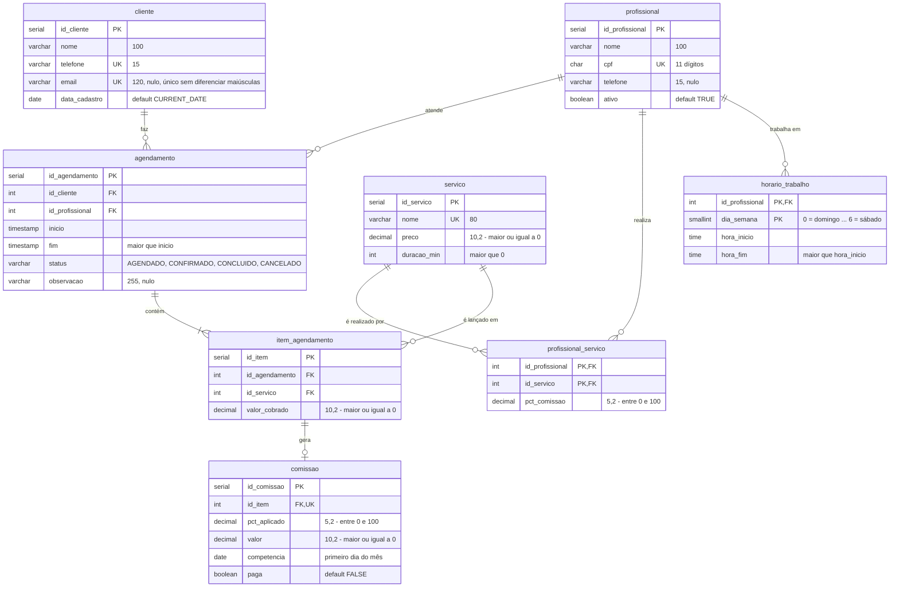

## Restrições que o diagrama não mostra

- `agendamento`: um profissional não pode ter dois agendamentos sobrepostos (`EXCLUDE USING gist`), exceto os `CANCELADO`.
- `item_agendamento`: o par (`id_agendamento`, `id_servico`) é único.
- As demais regras de negócio (expediente, serviço x profissional, cálculo do fim e da comissão) ficam em [`sql/02_triggers.sql`](../sql/02_triggers.sql).
